# Environnement de développement Odoo

🇬🇧 [English](README.md) · 🇫🇷 Français · 🤖 [Agents (MCP)](AGENTS.md) · 📝 [Changelog](CHANGELOG.md)

Environnement Docker rapide pour le développement Odoo : Odoo redémarre en ~2 secondes, toutes les
versions de 14.0 à la dernière sont à un changement de `.env`, plusieurs projets tournent côte à côte
derrière un proxy partagé avec une page hub, et tout se pilote avec une poignée de commandes depuis
le terminal **utils** — utilisables par un humain comme par une IA (MCP).

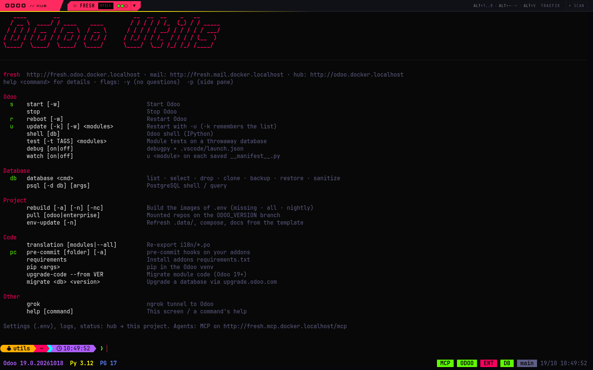

- [Fonctionnalités](#fonctionnalités)
- [Démarrage rapide](#démarrage-rapide)
- [Fonctionnement](#fonctionnement)
- [Le hub](#le-hub)
- [Les terminaux](#les-terminaux)
- [Commandes](#commandes)
- [Agents IA (MCP)](#agents-ia-mcp)
- [Configuration](#configuration)
- [Images et versions](#images-et-versions)
- [Garder un projet à jour](#garder-un-projet-à-jour)
- [Déboguer avec Cursor / VS Code](#déboguer-avec-cursor--vs-code)
- [Organisation du dépôt](#organisation-du-dépôt)
- [Dépannage](#dépannage)

## Fonctionnalités

- **Redémarrages instantanés** : Odoo tourne dans un pane tmux, `u mon_module` le relance avec `-u` en ~2s ; `u -w` attend et rapporte les erreurs du démarrage
- **Changement de version** : `ODOO_VERSION` / `PYTHON_VERSION` / `POSTGRES_VERSION` dans `.env` (panneau **Config** du hub), puis `rebuild`
- **Images partagées** : taguées par stack et par révision des Dockerfiles (`odoo-env/odoo:18.0-py3.10-latest-94f22b6c`) et réutilisées par tous les projets — passer de 19 à 18 puis 19 ne rebuild jamais deux fois, et un projet ne tourne jamais sur une image construite depuis d'autres fichiers ; celles inutilisées depuis `IMAGE_RETENTION_DAYS` sont supprimées automatiquement
- **Builds nightly** : `ODOO_BUILD=latest` ou une date ; `rebuild -n` rafraîchit le nightly, la barre de statut dit quand un plus récent existe
- **Plusieurs projets en même temps** : chaque projet prend le nom de son dossier (`aec`, `wms`…) derrière un proxy partagé ; **`http://odoo.docker.localhost`** affiche un onglet par projet (pastilles Odoo / BDD / Enterprise en direct, menu Odoo / Logs / Utils / Mail / MCP / Config, les projets arrêtés se démarrent depuis la page, onglets réordonnables par glisser-déposer, `Alt+1..9` change d'onglet)
- **Assistant de premier démarrage** : une nouvelle copie se configure depuis le hub (chemins, addons, base) — rien à éditer à la main
- **Capture des mails** : chaque mail sortant atterrit dans Mailpit (`http://<nom>.mail.docker.localhost`), y compris depuis les dumps restaurés
- **Débogueur** : `debug on` lance Odoo sous debugpy et écrit le `.vscode/launch.json` pour attacher Cursor / VS Code
- **Tenu à jour** : `env-update` met à jour les fichiers d'environnement d'un projet depuis le dépôt template ; le hub signale les nouvelles releases
- **Terminaux web** : logs Odoo et shell utils dans le navigateur (xterm.js, une seule palette pour tout)
- **Boîte à outils base de données** : backup, restore + sanitize (neutralize / anonymize), clone, drop, select, mode multi-db
- **Tests** : `test mon_module` lance les tests du module sur une base jetable (`--coverage` pour un rapport) ; `watch on` met à jour un module automatiquement quand son manifest est sauvegardé
- **Panes latéraux** : les commandes longues (`rebuild`, `test`, `db restore`, `translation`…) et interactives (`shell`, `psql`) s'ouvrent d'elles-mêmes dans un pane tmux latéral ; `-p` le fait pour n'importe quelle autre commande
- **Prêt pour les IA** : serveur MCP toujours actif par projet, `-y` / `NO_COLOR` sur chaque commande, rapport de démarrage de `u -w` (voir [`AGENTS.md`](AGENTS.md))
- **Découverte auto des addons** : dossiers imbriqués, `requirements.txt` installés au démarrage, clés ssh de l'hôte détectées pour les dépôts privés

## Démarrage rapide

### 1. Copier l'environnement

Une copie par projet. Le nom du dossier devient le nom du projet (`./19/_AEC` → `aec`, en
minuscules, sans le `_` initial) : préfixe des conteneurs (`aec_odoo`, `aec_utils`, `aec_db`) et des
URLs (`aec.odoo.docker.localhost`). Vos modules vont dans `addons/`.

### 2. Démarrer

```bash
docker compose up -d
```

Rien à éditer pour un premier essai : Odoo attend, et le hub (`http://odoo.docker.localhost`) ouvre
une boîte **first start** pour le projet — chemins enterprise / sources odoo (pré-remplis depuis un
projet voisin de la même version s'il existe, vide = Community), dossier des addons, base de données —
puis écrit `.env`, marque la configuration confirmée (`.data/volumes/shared/.setup_done`) et démarre
la stack. Les changements suivants passent par **Config** dans le hub. À la main, les clés qui comptent :

```bash
ODOO_VERSION=19.0
PYTHON_VERSION=3.12
POSTGRES_VERSION=17
ADDONS_PATH=./addons
ENTERPRISE_PATH=../enterprise      # optionnel
SELECTED_DB=main
```

Les secrets (`ENTERPRISE_KEY`, `NGROK_KEY`, `GITHUB_TOKEN`) vont dans `.env.secrets` (git-ignoré).

### 3. Utiliser

| Service | URL | Quoi |
|---------|-----|------|
| **Hub** | http://odoo.docker.localhost | un onglet par projet, chacun avec un menu Odoo / Logs / Utils / Mail / MCP / Config — la seule URL à retenir |
| Odoo    | http://`<nom>`.odoo.docker.localhost  | l'Odoo de ce projet |
| Logs    | http://`<nom>`.logs.docker.localhost  | logs Odoo en direct (pane tmux, lecture seule) |
| Utils   | http://`<nom>`.utils.docker.localhost | les commandes ci-dessous |
| MCP     | http://`<nom>`.mcp.docker.localhost/mcp | serveur MCP pour les agents IA |
| Mail    | http://`<nom>`.mail.docker.localhost  | mails sortants capturés par Mailpit (`COMPOSE_PROFILES=mail`) |
| Traefik | http://traefik.docker.localhost       | tableau de bord du proxy partagé (routeurs, services) |

Dans le terminal utils : `u mon_module` après une modification de code, `db restore ma_base` pour
charger un dump client, `test mon_module` pour lancer ses tests, `help` pour le reste.

## Fonctionnement

### Une stack par projet, un proxy pour tous

```
docker compose up -d  (projet aec)             docker compose up -d  (projet wms)
┌──────────────────────────────────┐           ┌──────────────────────────────────┐
│ aec_db      PostgreSQL           │           │ wms_db                           │
│ aec_odoo    Odoo dans un pane tmux│          │ wms_odoo                         │
│ aec_utils   commandes, MCP, statut│          │ wms_utils                        │
│ aec_mail    Mailpit (optionnel)  │           │ wms_mail                         │
└───────────────┬──────────────────┘           └───────────────┬──────────────────┘
                │ réseau odoo_proxy                            │
         ┌──────┴───────────────────────────────────────────────┴──────┐
         │ odoo_proxy_traefik   *.docker.localhost → le bon conteneur   │
         │ odoo_proxy_hub       http://odoo.docker.localhost            │
         └─────────────────────────────────────────────────────────────┘
```

- **db** : PostgreSQL, données dans `.data/volumes/db-container/pgdata` (bind mount dans le dossier du projet).
- **odoo** : le serveur Odoo de la version choisie, démarré dans un pane tmux par `odoo_runner.sh`
  (commande construite depuis `.env` : `-d SELECTED_DB`, `ODOO_ARGS`, debugpy), filestore et sessions
  dans `.data/volumes/odoo-container/odoo`. Votre `ADDONS_PATH` est monté sur `/mnt/extra-addons`,
  `ENTERPRISE_PATH` sur `/mnt/enterprise-addons`, `ODOO_PATH` sur `/opt/odoo` (miroir en lecture seule
  pour la découverte des modules et `upgrade-code`). Les scripts de l'environnement sont montés, pas
  copiés dans l'image.
- **utils** : la boîte à outils — les commandes, un shell zsh dans tmux, le serveur MCP (port 8300 à
  l'intérieur, servi par le proxy), le démon de statut (`status.py`) qui alimente les barres tmux et le
  hub, les terminaux web (`.data/web-terminal/server.py`, Python standard). Il parle à Docker par la
  socket (`docker exec` vers odoo / db, `docker compose` pour `rebuild`).
- **mail** (`COMPOSE_PROFILES=mail`) : Mailpit ; l'entrypoint odoo pointe `smtp_server` / `smtp_port`
  de `odoo.conf` dessus et chaque `ir.mail_server` des bases de dev est réécrit vers lui à chaque démarrage.
- **odoo_proxy** (`.data/proxy/`) : Traefik (ports 80 et 8080 sur `127.0.0.1` uniquement) et le hub.
  Démarré par le premier projet qui se lance (`ensure_proxy` dans l'entrypoint utils), partagé par tous,
  jamais arrêté par le `docker compose down` d'un projet. Les conteneurs de chaque projet portent des
  labels Traefik (routeurs `<projet>-odoo|logs|utils|mcp|mail`), rien d'autre à configurer.
- **odoo_env_meta** (volume Docker partagé par tous les projets) : le registre des projets vus sur cette
  machine (`projects/<nom>` = dossier hôte), la couleur prise par chacun (`colors/`), le journal des
  actions du hub (`journal/`), l'étape d'un `rebuild` en cours (`progress/`), la dernière utilisation de
  chaque image (`last_used/`) et `prune.log`.

### Démarrer, redémarrer, mettre à jour

`start` / `reboot` / `update` (alias `s` / `r` / `u`) ne recréent jamais un conteneur : ils relancent
le pane Odoo avec `odoo_runner.sh [-d BASE] [-u MODULES]`, qui affiche un cartouche de démarrage
(chemins d'addons, modules, base), exécute le **garde-fou** (`odoo_guard.sh` : refuse de démarrer quand
un `ENTERPRISE_PATH` / `ODOO_PATH` monté est sur une autre série que `ODOO_VERSION`, une mauvaise série
chargée avec `-u` corrompant la base) et `exec` Odoo. D'où un redémarrage en ~2 s. `stop` envoie SIGKILL
(environnement de dev, le plus rapide possible). `-w` attend la ligne « HTTP service running » et
affiche les tracebacks de ce run s'il y en a — le même rapport que renvoie l'outil MCP `odoo_update`.

Avant chaque démarrage, `dev_db_bootstrap.sh` applique les réglages de dev sur la ou les bases qui vont
être servies (`report.url`, pas d'expiration de base, serveur mail vers Mailpit).

### Statut

`status.py --loop` (utils) lit les conteneurs par l'API Engine toutes les 2 s et écrit
`/var/shared/status.json` (`.data/volumes/shared/`) : versions, alertes rebuild / nightly / release,
pastilles de services (MCP / ODOO / ENT / DB / base), clés `.env` changées depuis la création des
conteneurs. Les barres de statut tmux des deux terminaux et les onglets du hub affichent ce fichier ;
le serveur MCP le sert sur `/status`. Un seul processus, pas de CLI `docker`, valeurs lentes en cache
(build installé, nightly, série enterprise, release du template).

## Le hub

`http://odoo.docker.localhost` est la page unique de l'environnement : un onglet par projet vu sur cette
machine, démarré ou non. La page reçoit son état par server-sent events (`/api/events`) : rien à
rafraîchir, jamais.

### Onglets

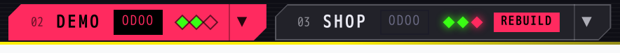

- **Numéro et nom** dans la couleur du projet (voir [Apparence](#les-terminaux)) ; le numéro est le
  raccourci `Alt+<n>`. L'onglet actif donne aussi le **favicon** (une lettre sur la couleur du projet) et
  le **titre** de l'onglet du navigateur (`AEC · UTILS`, préfixé `⚠` quand une pastille est rouge) : le
  hub se repère parmi vos autres onglets, même épinglé.
- **Pastille `ODOO`** : la vue courante (`ODOO`, `LOGS`, `UTILS`, `MAIL`, `MCP`). Chaque vue ouverte
  reste montée quand on change d'onglet : Odoo garde sa page, les terminaux leur historique.
- **Trois points** : le processus Odoo, PostgreSQL et Enterprise — vert ok, rouge arrêté / absent,
  orange quand Odoo a démarré **avec des erreurs** ou qu'Enterprise n'est pas sur la même série qu'Odoo.
  Survolez-les : l'infobulle donne le détail — dernier démarrage et son nombre d'erreurs, MCP up / down,
  version d'Enterprise, base sélectionnée, version et build d'Odoo.
- **Progression** à la place de la pastille de vue pendant les actions longues : `starting · 0:04`
  pendant le démarrage d'Odoo, `odoo 3/7 · 1:20` pendant un `rebuild` (image en cours, temps écoulé qui
  défile).
- **Drapeaux**, seulement quand quelque chose est à faire :

  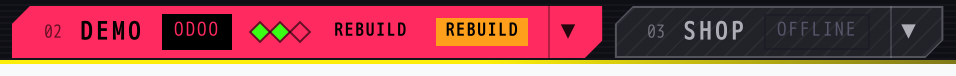

  `REBUILD` — les conteneurs ne correspondent plus au `.env` (révision d'image, version) · drapeau
  coloré clignotant `restart` / `rebuild` / `wipe db` — une clé `.env` a changé depuis la création des
  conteneurs, même depuis un éditeur (le hub surveille le fichier ; la couleur est le niveau de l'action
  nécessaire) · `v4.1` — une release plus récente de l'environnement est publiée · `setup` — premier
  démarrage en attente · `OFFLINE` — projet arrêté, onglet grisé avec une action **Start**. Les drapeaux
  sont **cliquables** : chacun ouvre le dialogue qui l'applique (restart / rebuild, update env, assistant
  de premier démarrage).
- **Ordre** : glissez un onglet pour le déplacer ; l'ordre est mémorisé dans le navigateur
  (`localStorage`), les nouveaux projets arrivent à la fin et `Alt+1..9` le suivent. Le hub rouvre sur le
  dernier projet / la dernière vue utilisés et retient la dernière vue de chaque projet.
- **Clic molette** sur un onglet : la vue courante de ce projet s'ouvre dans un nouvel onglet du
  navigateur (pratique pour un terminal sur un second écran). `#aec/utils` dans l'URL met une vue en
  favori ; `logs.` / `utils.<nom>.docker.localhost` ouvrent le hub sur cette vue.

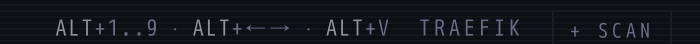

- **Clavier** (quand la page du hub a le focus, pas une iframe — cliquez d'abord la barre du haut) :
  `Alt+1..9` onglet par position, `Alt+←/→` projet démarré précédent / suivant, `Alt+V` vue suivante du
  projet courant, `Échap` ferme un dialogue ou le panneau Config.
- **TRAEFIK** ouvre le tableau de bord du proxy ; **+ SCAN** enregistre les copies du template trouvées
  sous un dossier de l'hôte (3 niveaux) sans les démarrer — les onglets apparaissent arrêtés, prêts pour
  **Start** :

  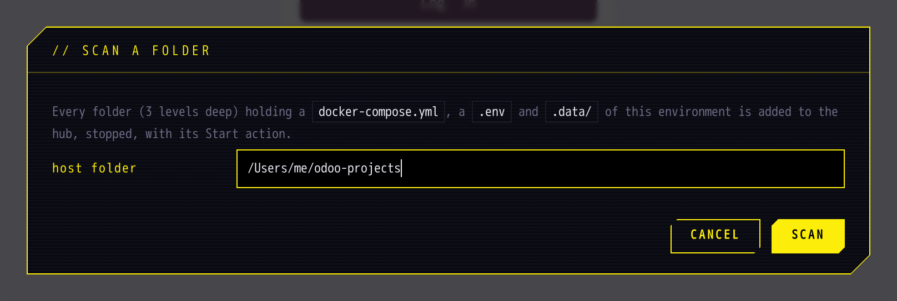

### Menu d'un onglet

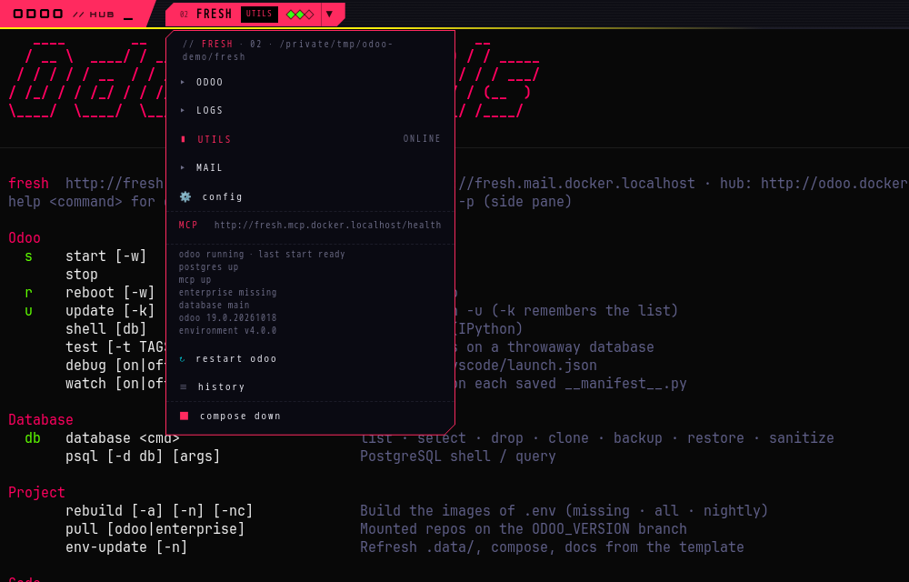 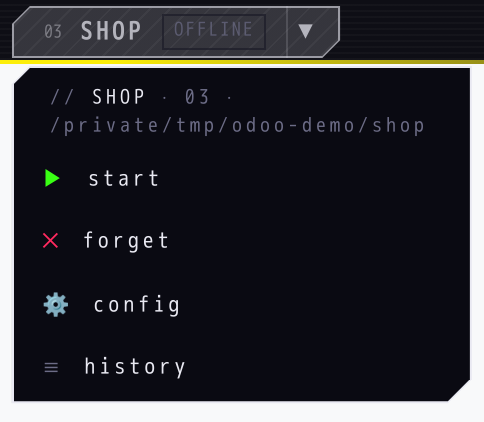

Les vues, puis **Config**, l'URL **MCP** (ouvre son `/health`), un bloc de statut (versions, base,
chemins), **restart odoo**, **history** (journal des actions lancées depuis le hub ; la dernière et son
résultat s'affichent directement dans l'entrée du menu) et **compose down** (arrête le projet, données
conservées). Un projet arrêté reçoit **Start**, **forget** (retire son onglet jusqu'au prochain
`docker compose up` ; le dossier n'est pas touché), **Config** et **history** ; **update env** apparaît
quand une release plus récente est publiée. Chaque action destructive demande une confirmation qui dit
ce qui est conservé.

Les actions lancent `docker compose` dans un conteneur `docker:cli` jetable (start, down, restart,
premier démarrage) ou une commande utils dans le conteneur utils du projet (`restart odoo`,
`env-update`). `rebuild` est à part : il pose des questions, le hub **le tape donc dans le terminal
utils du projet** — immédiatement si le prompt est libre, sinon il attend qu'une commande en cours
rende la main et démarre alors (`› hub: rebuild`).

### Panneau Config

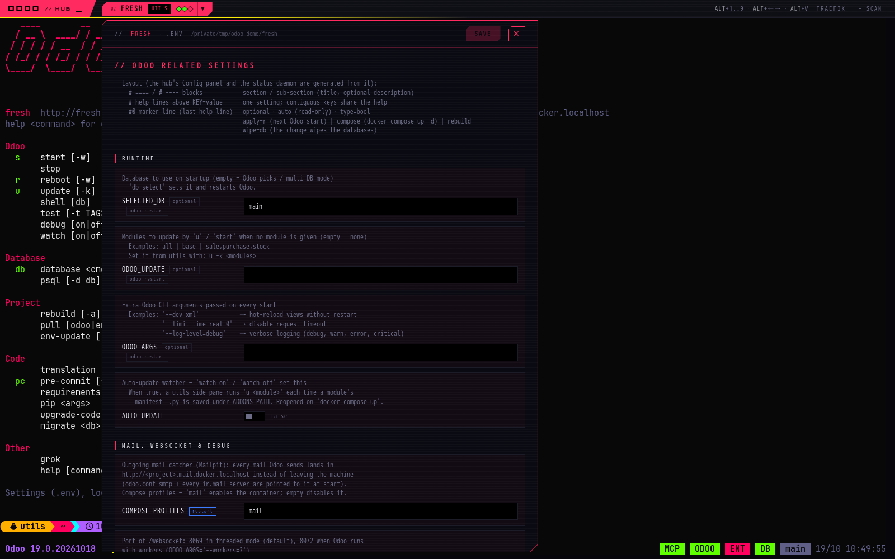

Le `.env` du projet sous forme de formulaire **généré depuis le fichier lui-même** : les blocs `# ===` /
`# ---` sont les sections, les commentaires au-dessus de chaque clé son texte d'aide, le marqueur `#@`
d'une clé donne son widget et son badge. Rien n'est codé en dur dans le hub : une clé ajoutée au `.env`
avec la même mise en page obtient sa ligne.

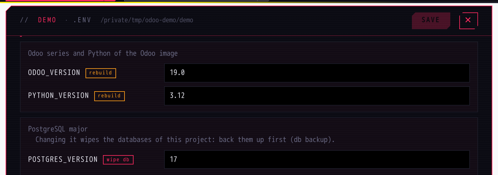
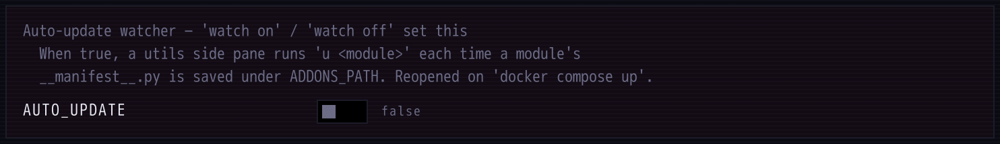

- **Badges** à côté d'une clé : `rebuild` / `wipe db` (ce que coûte son changement), `optional`, `auto`
  (gérée par l'environnement, lecture seule — les révisions d'images par exemple).
- **Widgets** : interrupteur pour les clés `true/false`, champ texte sinon ; la valeur courante est celle
  tapée dans le fichier, commentaires et mise en page sont préservés à la sauvegarde.
- **Bouton Save** : désactivé tant que rien n'a changé, puis il compte les changements et **prend la
  couleur de l'action la plus lourde qu'ils demandent** :

  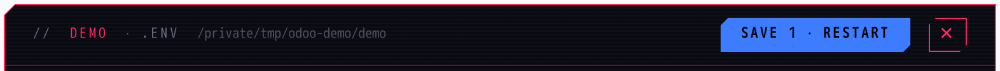
  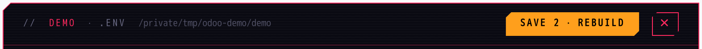
  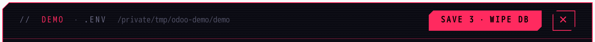

  bleu **restart** (`docker compose down` + `up -d`, données conservées — appliqué depuis le hub tout
  de suite), orange **rebuild** (pile de versions : tapé dans le terminal utils), rouge **wipe db**
  (`POSTGRES_VERSION` : les bases sont supprimées, sauvegardez-les d'abord). Une fois sauvé, l'action
  correspondante est proposée.
- **Dialogue `.env changed`** : le hub remarque aussi une clé modifiée hors du panneau (éditeur,
  `conf_set` par un agent) et explique ce qu'elle demande, avec un bouton **later** qui ne fait que
  reporter — le drapeau reste sur l'onglet :

  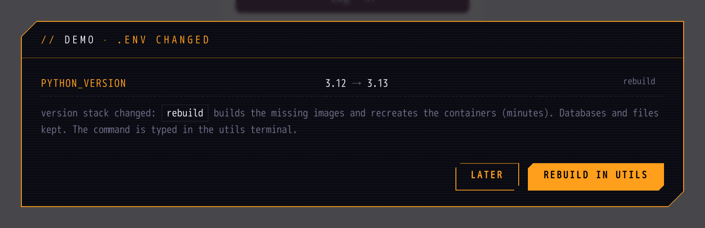

### Premier démarrage

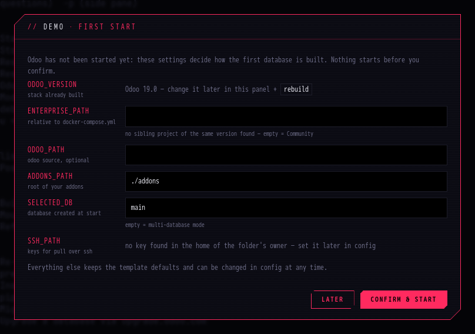

Un projet dont `.data/volumes/shared/.setup_done` n'existe pas encore reçoit l'assistant dès que son
onglet apparaît : chemins **pré-remplis depuis un projet voisin de la même version**, dossier des addons,
base. Odoo attend la confirmation (son pane de logs le dit) : une copie fraîche ne démarre jamais sur de
mauvais chemins.

### Sécurité

Le proxy n'écoute que sur `127.0.0.1` (ports 80 et 8080) et chaque action du hub porte un jeton généré
à son démarrage (`X-Hub-Token`) : rien sur le réseau local ne peut atteindre les terminaux ni démarrer /
arrêter un projet.

## Les terminaux

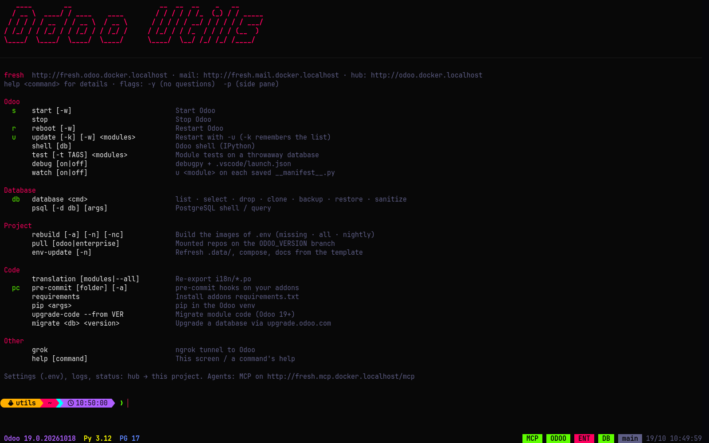
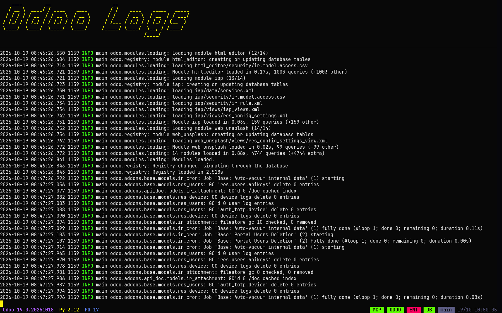

Deux sessions tmux, servies dans le navigateur par xterm.js (vues **Logs** et **Utils** du hub, ou les
URLs directes) et accessibles avec `docker exec -it <nom>_utils tmux attach` pour un terminal natif.

- **Logs** (conteneur odoo) : un pane logo et le pane du processus Odoo — la sortie du serveur en
  direct, en lecture seule. Chaque démarrage imprime un **en-tête** (ligne de commande, chemins des
  addons, requirements, base) : la frontière entre deux runs se retrouve d'un coup d'œil en remontant.
  Quand le garde-fou refuse de démarrer, l'explication s'affiche là. Avec `ODOO_IOT_BOX=true` un
  troisième pane montre la mise en place de l'IoT Box.
- **Utils** (conteneur utils) : un zsh interactif (Oh My Zsh, autosuggestions, coloration syntaxique,
  prompt Starship) où l'on tape les commandes ci-dessous. `help` réaffiche l'écran d'accueil (`clear`
  aussi), `help <commande> [sous-commande]` son `--help` (`help db restore`).

### Taper moins

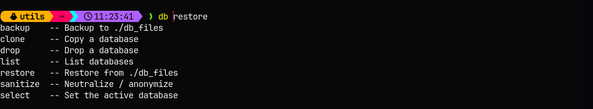

- **Complétion** de chaque commande, de ses sous-commandes et options avec leur description, et des
  **noms de modules** (`u mon_mod<Tab>`, depuis tous les dossiers d'addons — la liste est rafraîchie à
  chaque démarrage / `u` / `test`, un module ajouté après `compose up` est donc connu) et des **noms de
  bases** (`db select <Tab>`, `psql -d <Tab>`). `u` accepte aussi des motifs : `u mon_*` met à jour tous
  les modules correspondants.
- **Suggestions** : le texte gris après le curseur est la dernière commande de l'historique qui
  correspond, `→` l'accepte. Le plugin `you-should-use` rappelle l'alias quand on tape la forme longue.
- **Sélecteurs** : une commande à qui il manque un choix le demande au lieu d'échouer — `db select`
  liste les bases, `db restore <nom>` les dumps de `./db_files` (pris sans demander s'il n'y en a qu'un),
  `pre-commit` / `upgrade-code` les chemins d'addons et les modules :

  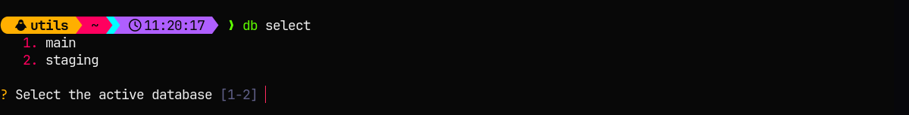

- **Les erreurs d'usage restent dans le prompt** : un mauvais argument affiche la ligne d'usage et un
  rappel `See:`, aucun pane ouvert, rien de lancé :

  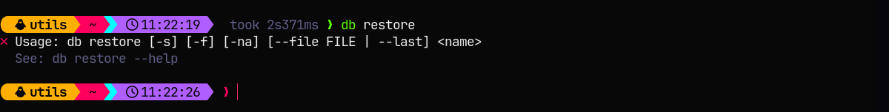

### Lire le résultat

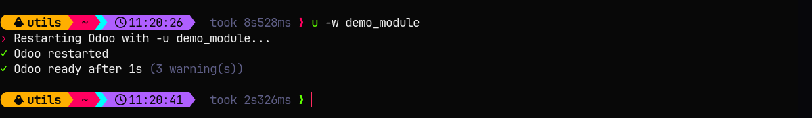

- **Prompt** : l'horloge à gauche (en direct, `TERMINAL_TZ`), `took 8s528ms` après toute commande de
  plus d'une seconde, un `❯` rouge après un échec.
- **`u -w` / `r -w`** : attend le démarrage et annonce *ready after Ns* avec le nombre d'avertissements,
  ou les tracebacks de ce démarrage seulement, suivis de quoi faire ensuite :

  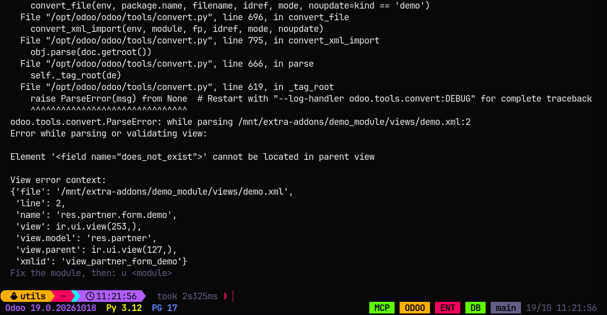

  C'est le même rapport que reçoivent le **restart odoo** du hub et l'`odoo_update` des agents.
- **Panes latéraux** : ils laissent le prompt libre pour les commandes longues (`rebuild`, `test`,
  `migrate`, `translation`, `upgrade-code`, `pre-commit`, `requirements`, `db restore|backup|sanitize`)
  et interactives (`shell`, `psql`, `grok`, `watch`) :

  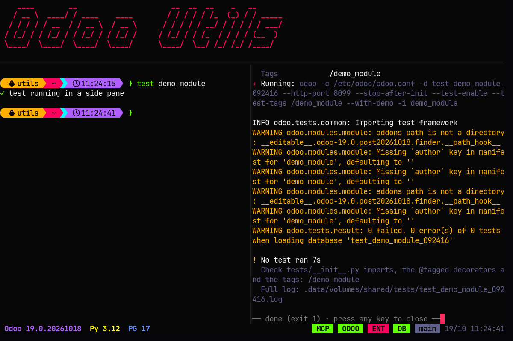

  le pane s'ouvre **une fois les arguments valides** (une erreur d'usage ou `--help` reste dans le
  prompt), **se ferme tout seul en cas de succès** (`done · closing`) et **reste ouvert en cas d'erreur
  ou d'avertissement** (`done (exit 1) · press any key to close`) pour que la sortie soit lue avant de
  disparaître ; un pane resté ouvert est fermé au lancement de la commande suivante. Un second pane
  d'une commande encore en cours reçoit un suffixe (`test·2`). `-p` ouvre un pane pour n'importe quelle
  autre commande (`db list -p`). Sans terminal (agents, `docker exec`, pipes) tout s'exécute en ligne et
  les confirmations échouent au lieu de bloquer.
- **Commandes transmises par le hub** (`rebuild` après un changement de `.env`) : tapées dans ce
  terminal pour que leurs confirmations se répondent là où l'on est — tout de suite si le prompt est
  libre, sinon mises en attente et lancées avec un préfixe `› hub:` quand la commande en cours rend la
  main.

### Barre de statut

 

À gauche : les versions de la pile (Odoo et build, Python, PostgreSQL) et les alertes — `⇡` un nightly
plus récent existe (`rebuild -n`), `rebuild` les conteneurs sont en retard sur le `.env`, `v4.1` une
release plus récente. À droite : les pastilles **MCP** (serveur qui répond), **ODOO** (processus
démarré ; rouge pendant un redémarrage), **ENT** (Enterprise monté et sur la même série), **DB**
(PostgreSQL démarré), la base sélectionnée (`multi-db` si aucune), puis la date et l'horloge. Les deux
terminaux affichent la même barre ; elle se rafraîchit seule.

### Souris et presse-papiers

- La **molette** fait défiler l'historique (copy-mode tmux, `q` ou redescendre pour en sortir), un
  **glisser** sélectionne et **copie dans le presse-papiers système** au relâchement (OSC 52 via
  xterm.js — rien à installer, fonctionne dans le navigateur comme via `docker exec -it … tmux attach`).
- Clics et molette sur le **pane logo** sont redirigés vers le pane principal : le logo ne vole jamais le
  focus.
- `.config/terminal.conf` : police et taille, forme / clignotement du curseur, longueur du scrollback,
  appliqués aux deux terminaux au prochain `docker compose up`.

### Apparence

Une seule palette pour le hub, les terminaux, tmux, le prompt et la sortie des commandes
(`.data/scripts/lib/theme.sh`, hub `.data/proxy/static/hub.css`) ; seule la **couleur primaire** est
propre au projet — hachée depuis son nom, la couleur libre suivante de la palette quand un autre projet
de la machine l'affiche déjà, ou `PROJECT_COLOR` dans `.env` (un nom de la palette ou `#rrggbb`). Elle
colore l'onglet du hub, le favicon, les logos et le prompt de ce projet : deux terminaux côte à côte ne
se confondent jamais. Prompt dans `.config/utils/starship.toml`, alias zsh personnels dans
`.config/utils/.zshrc` (chargé après le `zshrc.sh` de l'environnement, jamais écrasé).

## Commandes

Tapez `help` dans le terminal utils pour la vue d'ensemble et `help <commande> [sous-cmd]` (ou
`<commande> --help`) pour le détail. Chaque commande (sauf `psql` / `pip`, qui transmettent leurs
arguments) accepte les **flags globaux** :

| Flag | Effet |
|------|-------|
| `-y`, `--yes` | répond oui à toutes les confirmations (obligatoire sans terminal : une question sans tty échoue au lieu de bloquer) |
| `-p`, `--pane` | lance la commande dans un nouveau pane latéral du terminal utils pour continuer à travailler (voir [Les terminaux](#les-terminaux)) |
| `--no-color` | sortie sans couleur (automatique si la sortie est redirigée ou `NO_COLOR` défini) |

Codes de sortie : `0` ok, `1` erreur, `2` avec `-w` : Odoo a démarré **avec des erreurs** (le rapport les liste).

### Odoo

| Commande | Alias | Description |
|----------|-------|-------------|
| `update [-k] [-w] [-d DB] MODULES` | `u` | Redémarre Odoo avec `-u MODULES` (liste séparée par des virgules, motifs `my_*`, `all`). `-k` mémorise la liste dans `ODOO_UPDATE` pour qu'un `u` sans argument la réutilise ; `-w` attend la fin du démarrage et rapporte les erreurs ; `-d` choisit la ou les bases (`all` = toutes les bases Odoo) — demandé quand `SELECTED_DB` est vide |
| `reboot [-w]` | `r` | Redémarre Odoo sans mise à jour de module |
| `start [-w]` | `s` | Démarre Odoo s'il est arrêté |
| `stop` | | Arrête Odoo (SIGKILL, instantané) |
| `shell [db]` | | Shell Odoo (IPython : complétion, historique, `obj?`) dans un pane latéral |
| `test [-t TAGS] [--on DB] [--keep] [--no-demo] [--coverage] [-v] <modules>` | | Lance les tests des modules (`--test-enable`) sur une base jetable `test_<module>_<heure>` — neuve avec données de démo et `-i`, ou clone de `--on DB` avec `-u` — puis la supprime. L'Odoo en cours n'est pas touché ; code 1 si un test échoue ; log complet dans `.data/volumes/shared/tests/`. `--coverage` affiche la couverture des modules testés et écrit un rapport HTML sous `.data/volumes/odoo-container/odoo/coverage/` |
| `debug [on\|off]` | | Lance Odoo sous **debugpy** et écrit `.vscode/launch.json` (`Attach: Odoo (<nom>)`, mappings de chemins pour vos addons, Odoo et Enterprise). Le port est publié sur un port libre de l'hôte (ou `DEBUGPY_PORT`) ; `debug` seul l'affiche. `DEBUGPY=true` persiste à travers `r` / `u` |
| `watch [on\|off]` | | Pane latéral qui lance `u <module> -w` à chaque sauvegarde d'un `__manifest__.py` sous `addons/` (seuls les manifests déclenchent). Persisté dans `.env` (`AUTO_UPDATE`), rouvert au `compose up` |

### Base de données (`db`)

| Commande | Description |
|----------|-------------|
| `db` | Vue d'ensemble : base sélectionnée et liste |
| `db list` | Bases avec taille et version Odoo, la base sélectionnée est marquée ● |
| `db select [nom]` | Définit `SELECTED_DB` et redémarre Odoo (sélecteur si omis ; demande confirmation si la base n'existe pas) |
| `db drop [-f] <nom>` | Supprime une base et son filestore. `-f` réinitialise la base **sélectionnée** (stop → drop → start sur une base vierge) |
| `db clone [-f] <src> <dst>` | Copie une base (et son filestore) ; `-f` remplace `dst` |
| `db backup [-fs] [--keep N] [nom]` | Zip dans `./db_files/<nom>_<date>.zip` ; `-fs` inclut le filestore ; `--keep N` ne garde que les N backups les plus récents de cette base |
| `db restore [-s] [-f] [-na] [-F FICHIER \| --last] <nom>` | Restaure un backup de `./db_files/` dans `<nom>` (créée, ou remplacée seulement si elle existe), puis neutralize + anonymize. `-s` la sélectionne, `-na` saute la sanitization, `-F` choisit le fichier sans sélecteur (si `./db_files/` ne contient qu'un seul backup il est pris directement), `--last` prend le backup le plus récent de `<nom>` |
| `db sanitize [-a] [-F [FICHIER]] [nom]` | Neutralise (crons, mail, paiement…) et/ou anonymise (emails → `@test.test`, admin/admin) une base ou un fichier de backup |

Formats de backup : `.sql`, `.dump`, `.zip`, `.7z`, `.tar.gz` (le format Odoo avec `filestore/` est
géré). Restore et clone mettent Odoo en pause quand il peut tenir la base (mode multi-db) et le
redémarrent.

### Projet

| Commande | Description |
|----------|-------------|
| `rebuild [-a] [-n] [-nc]` | Construit les images manquantes pour la stack `.env` et recrée les conteneurs dessus (quelques secondes si elles existent) ; `-n` reconstruit l'image odoo sur le dernier nightly, `-a` reconstruit les deux, `-nc` sans le cache de build ; fait un `pull` des repos d'abord ; l'onglet du hub montre chaque étape ; `docker compose` continue de fonctionner depuis l'hôte ensuite |
| `pull [odoo\|enterprise] [--build DATE\|latest] [-f]` | Repos git de `ENTERPRISE_PATH` / `ODOO_PATH` → branche `ODOO_VERSION`, au commit du nightly `ODOO_BUILD` (ou la tête avec `latest`) |
| `env-update [-n] [--ref REF \| --from CHEMIN]` | Met à jour les fichiers d'environnement de ce projet depuis le dépôt template (`ENV_TEMPLATE_REPO` / `ENV_TEMPLATE_REF` dans `.env`) ou une copie locale (`--from`) — voir [Garder un projet à jour](#garder-un-projet-à-jour). `-n` prévisualise |
| `requirements` | Installe les `requirements.txt` des addons dans le venv Odoo |
| `pip <args>` | pip dans le venv Odoo |
| `psql [-d db] [args psql]` | Shell PostgreSQL / requêtes ponctuelles |

### Code

| Commande | Alias | Description |
|----------|-------|-------------|
| `translation MODULES\|--all [-l LANG\|-L] [--pot]` | | Ré-exporte les `i18n/*.po` de vos modules (sélecteur sans argument ; `-L` toutes les langues présentes) |
| `pre-commit [DOSSIER] [-a]` | `pc` | Lance les hooks de `.config/.pre-commit-config.yaml` (synchronisé dans `addons/.pre-commit-config.yaml` — à ignorer dans le dépôt de vos addons — pour que l'IDE voie les mêmes hooks) |
| `upgrade-code --from VER [--to VER] [--module M] [--dry-run]` | | Migre le code des modules avec les scripts `upgrade_code` d'Odoo plus ceux de `.data/migration_scripts/` (nécessite un runtime Odoo 19+) |
| `migrate <db> <version>` | | Migre une base via upgrade.odoo.com (`ENTERPRISE_KEY`) |

### Autres

| Commande | Description |
|----------|-------------|
| `grok` | Tunnel ngrok vers Odoo dans un pane latéral (`NGROK_KEY`) |
| `help [commande]` | Vue d'ensemble ou aide détaillée |
| `bash .data/tests/env_test.sh` (hôte) | Auto-test de l'environnement : deux copies jetables derrière le proxy, hub, URLs, MCP, mail, commandes principales, puis nettoyage (`-1` un seul projet, `-k` conserver, `--clean`) ; `python3 .data/tests/hub_test.py` teste le parseur `.env` du hub |

### Services toujours actifs

Ce qui était des commandes est désormais automatique : le **proxy** démarre avec le premier projet, le
**serveur MCP** avec le conteneur utils (pastille **MCP** rouge quand il est tombé, log dans
`.data/volumes/shared/mcp.log`), les images partagées inutilisées sont **supprimées** chaque jour
(`IMAGE_RETENTION_DAYS`), le **statut** et les **réglages** vivent dans le hub (drapeaux des onglets,
panneau Config). Les agents et les scripts gardent les backends bruts sous `.data/scripts/internal/`
(`status.sh`, `conf.sh`, `logs.sh`, `check_versions.sh`) — voir [`AGENTS.md`](AGENTS.md).

## Agents IA (MCP)

Le conteneur utils fait tourner un serveur MCP (Streamable HTTP, démarré avec le conteneur, servi par
le proxy sur `http://<nom>.mcp.docker.localhost/mcp`) qui expose les commandes ci-dessus sous forme
d'outils : `odoo_status`, `odoo_update`, `odoo_restart` / `odoo_start` / `odoo_stop`,
`odoo_wait_ready`, `odoo_logs`, `odoo_logs_since`, `odoo_shell` / `odoo_shell_commit`, `odoo_test`
(avec `coverage`), `odoo_model_info`, `odoo_xmlid`, `odoo_module_list`, `db_list` / `db_select` /
`db_backup` / `db_restore` / `db_drop` / `db_clone` / `db_query`, `conf_set`, `check_versions`,
`repos_pull`, `translation_export`, `pre_commit`, `requirements_install` — plus deux prompts
(`migrate_module`, `debug_error`). `/status` sert le `status.json` du projet en direct (utilisé par le
hub), `/health` répond `ok`. Configuration client (Cursor `~/.cursor/mcp.json`, Claude Desktop) :

```json
{ "mcpServers": { "odoo-<nom>": { "url": "http://<nom>.mcp.docker.localhost/mcp" } } }
```

Les agents sans MCP peuvent appeler les scripts directement :

```bash
U="docker exec -u utils <nom>_utils bash /home/utils/odoo_custom_docker/.data/scripts"
$U/commands/update.sh -y -w mon_module     # redémarre avec -u, attend, code 2 si erreurs
$U/internal/logs.sh -e                     # tracebacks du run en cours
$U/commands/test.sh -y mon_module          # tests sur une base jetable
```

Tout ce qu'un agent doit savoir est dans [`AGENTS.md`](AGENTS.md).

## Configuration

### `.env`

Le fichier est organisé en sections (`# ===`) et sous-sections (`# ---`), chaque clé précédée de ses
lignes d'aide et d'une ligne marqueur `#@ apply=r|compose|rebuild [wipe=db] [type=bool] [auto]
[optional]` qui dit comment un changement s'applique ; le panneau Config du hub et ses drapeaux en
sont générés — conservez la mise en page en ajoutant une clé. Les valeurs runtime (`SELECTED_DB`,
`ODOO_UPDATE`, `ODOO_ARGS`, `DEBUGPY`, `AUTO_UPDATE`) sont appliquées au prochain démarrage d'Odoo
(`r`), les montages et profils par `docker compose up -d`, la pile de versions par `rebuild`.

| Variable | Défaut | Description |
|----------|--------|-------------|
| `ODOO_VERSION` | `19.0` | 14.0 … 19.0 (`rebuild` pour appliquer) |
| `ODOO_BUILD` | `latest` | Date du build nightly (YYYYMMDD) ou `latest` |
| `PYTHON_VERSION` | `3.12` | Doit être compatible avec la version Odoo (`.data/compat.map`) |
| `POSTGRES_VERSION` | `17` | Doit être compatible ; la changer efface les bases |
| `IMAGE_RETENTION_DAYS` | `30` | Jours avant qu'une image partagée inutilisée soit supprimée (vérifié au démarrage puis chaque jour ; 0 = tout garder) |
| `ADDONS_PATH` | `./addons` | Vos addons (`/mnt/extra-addons` dans le conteneur) |
| `ENTERPRISE_PATH` | | Addons Enterprise (vide = Community) |
| `ODOO_PATH` | | Sources Odoo sur l'hôte (découverte des modules, `upgrade-code`, mappings du débogueur) |
| `SSH_PATH` | | `~/.ssh` de l'hôte monté en lecture seule dans utils (`pull` en ssh). Vide = détecté au premier démarrage : le `~/.ssh` de l'utilisateur propriétaire du dossier du projet quand il contient une clé, écrit ici pour le prochain `docker compose up -d`. Seuls les clés et `known_hosts` sont copiés pour l'utilisateur utils — le `ssh config` de l'hôte reste hors du conteneur |
| `SCAN_SUBFOLDERS` | `true` | Découvre les modules dans les dossiers imbriqués |
| `IGNORED_PATH` | | Dossiers exclus du scan |
| `SELECTED_DB` | `main` | Base active (`db select`). Vide = **mode multi-db** : Odoo démarre sans `-d`, la base se choisit dans le sélecteur web (`/web/database/selector`, `?db=`). Les commandes qui en ont besoin (`u`, `shell`, `psql`, `translation`, `db backup/sanitize`, `watch`) demandent alors laquelle, `u` propose aussi `all` ; Odoo ne sert ensuite que la ou les bases mises à jour jusqu'au prochain `r`. Restore / clone mettent Odoo en pause puisque n'importe quelle base peut être chargée ; les crons tournent sur toutes les bases (celles restaurées sont neutralisées) |
| `ODOO_UPDATE` | | Modules mis à jour par `u` / `start` sans argument (`u -k`) |
| `ODOO_ARGS` | | Arguments Odoo supplémentaires, ex. `--dev xml` |
| `AUTO_UPDATE` | `false` | Pane de mise à jour automatique (`watch on` / `watch off`) |
| `DEBUGPY`, `DEBUGPY_PORT` | `false`, | Odoo sous debugpy (`debug on/off`) ; port vide = un port libre de l'hôte choisi par Docker, jamais en conflit entre projets |
| `COMPOSE_PROFILES` | `mail` | `mail` lance le conteneur Mailpit. Vide = désactivé (`docker compose up -d` pour appliquer) |
| `ODOO_WS_PORT` | `8069` | Port vers lequel Traefik route `/websocket` : `8069` en mode threadé, `8072` avec `--workers` |
| `PROJECT_COLOR` | | Couleur du projet (onglet du hub, titres des terminaux, prompt, curseur) : un nom de la palette (`yellow cyan red purple green orange blue fg`) ou `#rrggbb`. Vide = choisie depuis le nom, une autre quand un projet de la machine l'a déjà (écrite ici alors) |
| `COMPOSE_PROJECT_NAME` | | Nom du projet : vide = nom du dossier (`./19/_AEC` → `aec`). À renseigner seulement si deux dossiers portent le même nom |
| `ENV_TEMPLATE_REPO`, `ENV_TEMPLATE_REF` | URL du template, | Dépôt / branche depuis lesquels `env-update` met l'environnement à jour (ref vide = branche par défaut du dépôt) |
| `ODOO_IOT_BOX` | `false` | Mode IoT Box intégré (Odoo 19+) : `iot_drivers` chargé, imprimantes virtuelles CUPS, pane de mise en place dans le terminal logs |
| `ODOO_IMAGE_REV`, `UTILS_IMAGE_REV` | auto | Révision des Dockerfiles (+ web terminal), partie du tag des images. Écrites par le conteneur utils au démarrage et par `rebuild` : ne pas éditer |
| `ENTERPRISE_KEY`, `NGROK_KEY`, `GITHUB_TOKEN` | | Secrets — à placer dans `.env.secrets` (`GITHUB_TOKEN` : `pull` sur les remotes https) |

### Chemins

Les chemins sont relatifs à `docker-compose.yml` :

```
projet/
├── docker-compose.yml
├── addons/
│   ├── mon_module/
│   └── custom-addons/        # les sous-dossiers sont scannés (SCAN_SUBFOLDERS=true)
│       └── autre_module/
└── ../enterprise/
```

```bash
ADDONS_PATH=./addons           # Même répertoire
ENTERPRISE_PATH=../enterprise  # Répertoire parent
```

Chaque dossier contenant un `__manifest__.py` est un module ; `generate_addons_path.sh` réécrit
`addons_path` dans `odoo.conf` à chaque démarrage et `check_requirements.sh` installe les
`requirements.txt` trouvés sous `ADDONS_PATH`. La liste des modules
(`.data/volumes/odoo-container/cache/.modules_list`) alimente la complétion et les motifs de `u` ; elle
est rafraîchie à chaque `u`.

### Fichiers de configuration

| Fichier | Description |
|---------|-------------|
| `.config/odoo.conf` | Configuration serveur Odoo (`addons_path`, `smtp_*` sont réécrits au démarrage) |
| `.config/terminal.conf` | Terminaux web : police, curseur, scrollback, fuseau horaire |
| `.config/utils/starship.toml` | Prompt du shell utils (placeholders `${THEME_*}`) |
| `.config/utils/.zshrc` | Vos alias et fonctions pour le shell utils (chargé après le `zshrc.sh` de l'environnement) |
| `.config/.pre-commit-config.yaml` | Hooks utilisés par `pre-commit` / `upgrade-code` |
| `.data/scripts/lib/theme.sh` | La palette (hub, terminaux, tmux, prompt, sortie des commandes) |
| `.data/compat.map` | Compatibilité Odoo / Python / PostgreSQL (lecture seule) |

`.config/odoo.conf` :

```ini
[options]
admin_passwd = odoo          ; Mot de passe master
without_demo = True          ; Désactiver données démo
; workers = 0                ; Nombre de workers (0 = désactivé)
; limit_memory_hard = 2684354560
; limit_time_real = 120
```

`.config/terminal.conf` :

```bash
WEBTERM_FONT_FAMILY='"JetBrainsMono Nerd Font", Consolas, Menlo, Ubuntu, monospace'
WEBTERM_FONT_SIZE=15
TMUX_CURSOR_STYLE=bar        # block, underline, bar
TMUX_CURSOR_BLINK=true
TMUX_SCROLLBACK=50000
TERMINAL_TZ=Europe/Paris     # horloges : barre de statut, prompt, shell utils
```

> Les polices sont rendues côté client (navigateur). Pour les icônes Nerd Font (prompt Starship), installez une Nerd Font localement :
> - **Linux** : `wget https://github.com/ryanoasis/nerd-fonts/releases/download/v3.4.0/JetBrainsMono.zip && unzip JetBrainsMono.zip -d ~/.local/share/fonts && fc-cache -f`
> - **macOS** : `brew install font-jetbrains-mono-nerd-font`
> - **Windows** : télécharger depuis https://www.nerdfonts.com/

Les modifications de `terminal.conf`, `starship.toml` ou de la palette prennent effet après
`docker compose restart <conteneur>` ; `odoo.conf` après `r`.

## Images et versions

Les images sont indépendantes du projet et taguées par stack **et par contenu des Dockerfiles**
(8 caractères hexa de `.data/scripts/image_rev.sh`) : tous les projets sur les mêmes versions et les
mêmes fichiers d'environnement les partagent, `docker compose up` ne reconstruit jamais une image qui
existe, et un projet dont les Dockerfiles ont changé (après `env-update`) obtient son propre tag au lieu
de réutiliser — ou de se faire orpheliner par — l'image d'un autre projet. Les entrypoints et les scripts
sont montés, pas copiés dans l'image : la plupart des changements ne demandent aucun rebuild. L'image
Odoo est construite en deux étapes (compilateurs et en-têtes restent dans le builder ; l'image finale
n'a que les bibliothèques d'exécution, l'interpréteur et le venv) et l'image utils n'embarque pas
Node.js : les terminaux web sont un bundle xterm.js versionné servi par un serveur Python en
bibliothèque standard. `pip` / `requirements` installent des wheels dans le conteneur Odoo ; un paquet à
compiler se met dans le Dockerfile.

| Service | Image |
|---------|-------|
| odoo | `odoo-env/odoo:<ODOO_VERSION>-py<PYTHON_VERSION>-<ODOO_BUILD>-<rev>` (ex. `odoo-env/odoo:19.0-py3.12-latest-94f22b6c`) |
| db | `odoo-env/db:<POSTGRES_VERSION>` |
| utils | `odoo-env/utils:<rev>` |

`ODOO_BUILD=latest` désigne le nightly du jour où l'image a été construite : un nightly plus récent ne
force jamais de rebuild (le `⇡` de la barre de statut le signale ; `rebuild -n` le rafraîchit). Chaque
démarrage note les images utilisées par le projet dans le volume partagé `odoo_env_meta` ; celles
inutilisées depuis `IMAGE_RETENTION_DAYS` sont supprimées automatiquement (au démarrage, puis chaque
jour, `prune.log` dans le volume).

### Changer de version Odoo

1. `ODOO_VERSION=18.0` dans le panneau **Config** du hub (et `PYTHON_VERSION` / `POSTGRES_VERSION` si
   besoin — la combinaison est validée contre `.data/compat.map`)
2. `rebuild` (dans un pane latéral, continuez à travailler pendant ce temps) — ne construit les images
   `18.0` que si aucun projet ne l'a déjà fait, passe les repos git de `ENTERPRISE_PATH` / `ODOO_PATH`
   sur la branche `18.0`, et recrée les conteneurs. `docker compose` continue de fonctionner depuis
   l'hôte ensuite (le build tourne dans un conteneur jetable qui voit le projet à son chemin hôte).

Compatibilité (`.data/compat.map`, défaut en premier) :

| Odoo | Python | PostgreSQL |
|------|--------|------------|
| 19.0 | 3.12, 3.13, 3.11, 3.10 | 17, 16, 15, 14, 13 |
| 18.0 | 3.12, 3.13, 3.11, 3.10 | 17, 16, 15, 14, 13, 12 |
| 17.0 | 3.10, 3.13, 3.12, 3.11 | 16, 15, 14, 13, 12 |
| 16.0 | 3.10, 3.12, 3.11, 3.9, 3.8, 3.7 | 15, 14, 13, 12, 11, 10 |
| 15.0 | 3.10, 3.12, 3.11, 3.9, 3.8, 3.7 | 14, 15, 13, 12, 11, 10 |
| 14.0 | 3.8, 3.10, 3.9, 3.7, 3.6 | 13, 12, 11, 10 |

## Garder un projet à jour

Chaque projet est une copie autonome avec son propre dépôt git. `env-update` (utils) récupère le
template (`ENV_TEMPLATE_REPO` / `ENV_TEMPLATE_REF`, ou une copie de travail locale avec `--from <chemin
hôte>`), montre ce qui a changé dans les fichiers d'environnement et l'applique :

- **Remplacés** : `.data/` (sauf `volumes/`, `host_project_path.map`), `docker-compose.yml`,
  `.dockerignore`, `AGENTS.md`.
- **Supprimés** : `README.md`, `README.fr.md`, `CHANGELOG.md`, `docs/`, `.gitignore` — ils appartiennent
  au dépôt du template et sont retirés d'une copie projet (le conteneur utils le fait à son premier
  démarrage, avec le `.git` copié ; `addons/` et son propre `.gitignore` ne sont jamais touchés).
- **Fusionné** : `.env` — valeurs conservées, nouvelles clés ajoutées avec leurs commentaires d'aide,
  clés obsolètes signalées.
- **Ajoutés seulement** : `.config/` (nouveaux fichiers ; un ancien `.config/utils/.zshrc` généré est
  remplacé par le fichier utilisateur réduit à des commentaires).
- **Jamais touchés** : `addons/`, `db_files/`, `.env.secrets`, volumes de données.

Relire avec `git diff`, committer, puis suivre les étapes affichées : `rebuild` si un Dockerfile a
changé (le tag de l'image change avec lui), `docker compose up -d` si le fichier compose a changé. Le
hub et le serveur MCP sont redémarrés par la commande elle-même quand leurs fichiers ont changé (en
arrière-plan, log dans `.data/volumes/shared/env-update.log`). `.data/.template_rev` mémorise le commit
du template pour que le passage suivant supprime aussi les fichiers abandonnés par le template. `-n`
prévisualise sans écrire.

**Releases.** `.data/VERSION` est la version de l'environnement (`4.0.0`, voir
[`CHANGELOG.md`](CHANGELOG.md)). Toutes les heures, la boucle de statut la compare à celle du template
sur `ENV_TEMPLATE_REF` (vide = branche par défaut du dépôt, c'est-à-dire la ligne de release courante —
`v4`) ; quand une plus récente est publiée, l'onglet affiche un drapeau `v4.1` et le hub propose **update
env** (lance `env-update -y` dans utils, affiche son rapport, puis propose le redémarrage si le fichier
compose a changé). Pour publier : incrémenter `.data/VERSION`, committer, pousser sur la branche de
release (en faire la branche par défaut du dépôt, ou renseigner `ENV_TEMPLATE_REF` dans les projets).

## Déboguer avec Cursor / VS Code

```
debug on            # Odoo redémarre sous debugpy, .vscode/launch.json reçoit "Attach: Odoo (<nom>)"
```

Ouvrir le dossier du projet dans l'IDE, poser des points d'arrêt dans vos addons, lancer cette
configuration (F5) : les mappings couvrent `ADDONS_PATH` → `/mnt/extra-addons`, `ODOO_PATH` →
`/opt/odoo` et `ENTERPRISE_PATH` → `/mnt/enterprise-addons`. Les points d'arrêt dans le code d'Odoo
fonctionnent quand `ODOO_PATH` est sur le commit du build (`pull`). Si l'IDE est ouvert sur un dossier
parent, copier la configuration dans le `launch.json` de ce workspace. `debug off` revient à un
démarrage normal.

## Organisation du dépôt

```
.
├── docker-compose.yml          la stack du projet (db, odoo, utils, mail)
├── .env                        réglages (panneau Config du hub) · .env.secrets pour les clés
├── addons/                     vos modules
├── db_files/                   backups (db backup / db restore)
├── .config/
│   ├── odoo.conf               configuration Odoo
│   ├── terminal.conf           terminaux : police, curseur, scrollback, fuseau
│   ├── utils/starship.toml     prompt · utils/.zshrc vos alias
│   └── .pre-commit-config.yaml hooks
└── .data/                      l'environnement (géré par env-update)
    ├── VERSION · compat.map · migration_scripts/
    ├── docker/{odoo,utils,db}/ Dockerfiles et entrypoints
    ├── proxy/                  Traefik + hub partagés (hub.py, static/hub.js, hub.css)
    ├── mcp/server.py           serveur MCP
    ├── web-terminal/           bundle xterm.js + server.py
    ├── scripts/
    │   ├── commands/*.sh       les commandes utils (un script chacune, fonctions zsh dans zshrc.sh)
    │   ├── internal/*.sh       backends sans commande : status, conf, logs, check_versions, prune, mcp
    │   ├── lib/*.sh            env, ui, panes, odoo, project, db, theme — chargés par common.sh
    │   ├── odoo_runner.sh · odoo_header.sh · odoo_guard.sh   le pane Odoo
    │   ├── status.py           démon de statut
    │   ├── zshrc.sh · completion.sh · tmux_setup.sh
    │   └── generate_addons_path.sh · check_*.sh · dev_db_bootstrap.sh · mail_catcher.sh · image_rev.sh
    ├── tests/                  env_test.sh (bout en bout), hub_test.py
    └── volumes/                données : db-container, odoo-container, shared (status.json, logs, tests)
```

## Dépannage

**Odoo n'a pas démarré / erreur de vue après `u`** — `u -w mon_module` fait la mise à jour et
rapporte les erreurs du démarrage ; l'onglet logs du hub montre tout le run.

**« start guard » dans le pane de logs** — un `ENTERPRISE_PATH` / `ODOO_PATH` monté est sur une autre
série que `ODOO_VERSION` : `pull` remet les repos sur la bonne branche, ou changez la version puis `rebuild`.

**Module affiché comme inconnu dans le cartouche de démarrage** — la liste des modules est rafraîchie à
chaque `u` ; vérifiez que le dossier contient un `__manifest__.py` et n'est pas sous `IGNORED_PATH`.

**L'onglet ou la barre de statut propose un rebuild** — les conteneurs qui tournent diffèrent de
`.env` : lancez `rebuild` (quelques secondes si les images existent). Un nightly plus récent n'est qu'une
indication : `rebuild -n` quand vous le voulez.

**Drapeau `RESTART` sur l'onglet** — une clé `.env` appliquée par compose a changé depuis la création
des conteneurs : `docker compose up -d` (le hub le propose).

**Espace disque** — les images partagées inutilisées depuis `IMAGE_RETENTION_DAYS` sont supprimées
chaque jour (`prune.log` dans le volume `odoo_env_meta` les liste) ; baissez la valeur pour libérer de
la place plus tôt.

**Aucune URL ne répond / hub vide** — le proxy partagé doit tourner : le `docker compose up -d` de
n'importe quel projet le démarre. Un port 80 déjà pris vient en général d'un ancien conteneur
`*_traefik` par projet d'une version précédente de cet environnement : `docker rm -f <projet>_traefik`,
puis `docker compose up -d`. Compose avertit « network odoo_proxy exists but was not created for
project … » à chaque démarrage : attendu, le réseau est partagé.

**Pastille MCP rouge** — le serveur est démarré par l'entrypoint utils ; `.data/volumes/shared/mcp.log`
dit pourquoi il s'est arrêté, `docker compose restart utils` le relance.

**Mettre à niveau une copie de projet depuis la version 3** — voir [`CHANGELOG.md`](CHANGELOG.md) :
`docker compose down` d'abord (son traefik tient le port 80), `env-update --from <chemin d'une copie
v4>` ou copier les nouveaux `docker-compose.yml`, `.env` (gardez vos valeurs) et `.data/`, puis
`rebuild` et `docker compose up -d`. Bases et filestore sont des bind mounts dans le dossier du projet :
rien n'est perdu. Mettez à jour l'entrée MCP de `~/.cursor/mcp.json`.

**Permission denied sur docker.sock (Linux)**

```bash
sudo chmod 666 /var/run/docker.sock                 # temporaire
```

```bash
sudo mkdir -p /etc/systemd/system/docker.socket.d   # permanent
sudo tee /etc/systemd/system/docker.socket.d/override.conf << EOF
[Socket]
SocketMode=0666
EOF
sudo systemctl daemon-reload && sudo systemctl restart docker.socket
```
